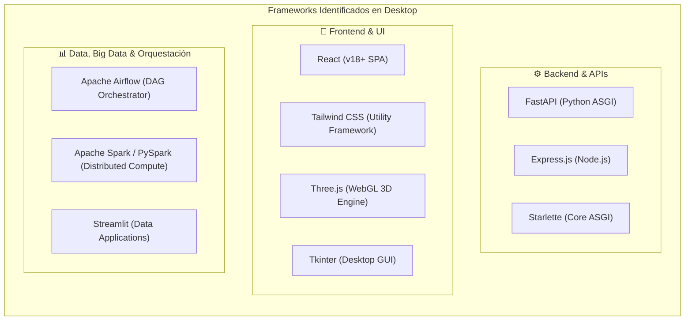

# 🏗️ Frameworks: Arquitectura, Usos y Comparativas

> **Definición Clave para la Prueba:**  
> Un **Framework** impone la arquitectura y el flujo de control de la aplicación (*Inversion of Control* o Principio de Hollywood: *"No nos llames, nosotros te llamamos"*). A diferencia de una librería, el framework llama a tu código, define el ciclo de vida y establece convenciones de carpetas y dependencias.

---

## 📑 Clasificación de Frameworks en tus Proyectos



---

## 1. Frameworks de Backend & APIs

### ⚡ FastAPI
* **Lenguaje:** Python 3.10+
* **Tipo:** Framework web asíncrono basado en ASGI, Pydantic y Starlette.
* **Proyectos donde lo usas:** `pruebas/Pipeline-analitica`, `Antigravit/AgenteIA`, `Antigravit/Entrevistador`, `Antigravit/gimnasio RIWI`, `Antigravit/HU_seman4_IA`, `Antigravit/RIWI_APP`, `Ruta_avanzada_IA/Desarrollo`.
* **Características Principales:**
  * Soporte nativo de `async` / `await` para concurrencia masiva sin hilos bloqueantes.
  * Inyección de dependencias modular (`Depends`).
  * Validación automática de datos y generación de documentación Swagger UI (`/docs`) y ReDoc (`/redoc`).
  * Serialización de alto rendimiento gracias a Pydantic v2 (escrito en Rust).
* **Patrón de Arquitectura Recomendado:** Clean Architecture / Hexagonal:
  ```
  app/
  ├── api/          # Routers y endpoints HTTP
  ├── core/         # Configuración (pydantic-settings), seguridad y constantes
  ├── models/       # Modelos ORM (SQLAlchemy)
  ├── schemas/      # Modelos de validación (Pydantic DTOs)
  ├── services/     # Lógica de negocio y casos de uso
  └── main.py       # Inicialización de FastAPI y middlewares
  ```

---

### 🟢 Express.js
* **Lenguaje:** JavaScript (ES6+) / TypeScript
* **Tipo:** Framework minimalista para Node.js basado en middlewares.
* **Proyectos donde lo usas:** `Riwi/ZOE-CARE`, `Antigravit/gimnasio RIWI`, `Antigravit/HU semana 10`, `Antigravit/RIWI OCR`.
* **Características Principales:**
  * Flujo de petición-respuesta lineal mediante `(req, res, next)`.
  * Ecosistema masivo de middlewares (CORS, Helmet, Morgan, Body-Parser).
  * Ideal para microservicios de coordinación de eventos que escuchan de AWS SQS o integran con servicios en Node.
* **Estructura Típica en tus Proyectos:**
  ```javascript
  import express from 'express';
  import cors from 'cors';
  
  const app = express();
  app.use(cors());
  app.use(express.json());
  
  app.post('/api/tasks', async (req, res) => {
    // Procesar evento o persistir
    res.status(201).json({ status: 'queued', data: req.body });
  });
  
  app.listen(3000, () => console.log('Server running on port 3000'));
  ```

---

## 2. Frameworks de Frontend & UI

### ⚛️ React (v18+)
* **Lenguaje:** JavaScript / TypeScript (JSX/TSX)
* **Tipo:** Framework/Librería declarativa basada en componentes y Virtual DOM.
* **Proyectos donde lo usas:** `Antigravit/Interview-Assistant`, `Antigravit/RIWI_APP`, `TokenSaver Web`.
* **Conceptos Clave para la Prueba:**
  * **Hooks Fundamentales:**
    * `useState`: Estado local reactivo.
    * `useEffect`: Efectos secundarios (llamadas a API, subscripciones, manipulación de DOM).
    * `useMemo`: Memorización de cálculos pesados para evitar re-renderizados innecesarios.
    * `useCallback`: Memorización de definiciones de funciones pasadas como props a componentes hijos.
  * **Concurrencia en React 18:** Soporte de `Suspense`, transiciones no bloqueantes (`useTransition`) y Server Components.

---

### 🎨 Tailwind CSS
* **Tipo:** Framework CSS Utility-First.
* **Proyectos donde lo usas:** `Riwi/Proyecto_spa_previa1`, `Riwi/Pruebas SPA simulacro`, `Antigravit/Interview-Assistant`, `Ruta_avanzada_IA`.
* **Puntos Fuertes:**
  * Elimina la necesidad de inventar nombres de clases BEM (`.card__header--active`).
  * Purga automática en compilación (CSS resultante < 20 KB en producción).
  * Fácil soporte de diseño responsivo mediante prefijos de breakpoint (`sm:`, `md:`, `lg:`, `xl:`).
  * Soporte nativo de temas oscuros (`dark:bg-slate-900 dark:text-white`).

---

## 3. Frameworks de Data Engineering & Orquestación

### 🌪️ Apache Airflow
* **Lenguaje:** Python
* **Tipo:** Plataforma de orquestación de flujos de trabajo basada en DAGs.
* **Proyectos donde lo usas:** `AIRFLOW/airflow`, `pruebas/Pipeline-analitica`, `Antigravit/final_project`.
* **Componentes Principales:**
  1. **Webserver:** Interfaz gráfica para inspeccionar ejecuciones, logs y estados de tareas.
  2. **Scheduler:** El motor que monitorea DAGs y encola las tareas listas para ejecutarse.
  3. **Executor:** Define cómo se ejecutan las tareas (LocalExecutor en una sola máquina, CeleryExecutor o KubernetesExecutor para múltiples workers distribuidos).
  4. **Metastore:** Base de datos relacional (PostgreSQL) que guarda el estado de los DAGs, conexiones y variables.
  5. **Worker:** Proceso que ejecuta físicamente la tarea.
* **Buenas Prácticas:**
  * **Idempotencia:** Ejecutar el mismo DAG varias veces para la misma fecha debe producir exactamente el mismo resultado sin duplicar datos.
  * **Tareas atómicas y ligeras:** No procesar DataFrames pesados en el scheduler ni dentro de Airflow; delegar a Spark, DuckDB o SQL en el Data Lakehouse.

---

### 🔥 Apache Spark / PySpark
* **Lenguaje:** Scala / Python / Java / SQL
* **Tipo:** Motor de procesamiento distribuido masivo en memoria.
* **Proyectos donde lo usas:** `pruebas/Pipeline-analitica` (`spark_medallion_job.py`, `spark_gold_models.py`), imagen Docker `apache/spark:3.5.1`.
* **Conceptos Clave para la Prueba:**
  * **Driver vs Executors:** El *Driver* ejecuta el programa principal, crea el `SparkSession` y coordina el plan de ejecución; los *Executors* son los nodos que procesan las particiones de datos en paralelo.
  * **RDD vs DataFrame:** RDD (Resilient Distributed Dataset) es la abstracción de bajo nivel; DataFrame es la API optimizada de alto nivel con soporte del optimizador **Catalyst** y el motor de generación de código **Tungsten**.
  * **Transformaciones vs Acciones:**
    * *Transformaciones (Lazy Evaluation):* `map`, `filter`, `select`, `groupBy`, `join`. No se ejecutan de inmediato; crean un grafo de ejecución (DAG).
    * *Acciones (Eager Execution):* `count`, `collect`, `write.save`, `show`. Disparan la ejecución física de las transformaciones acumuladas.

---

### 📊 Streamlit
* **Lenguaje:** Python
* **Tipo:** Framework para aplicaciones web de datos y dashboards analíticos.
* **Proyectos donde lo usas:** `pruebas/Pipeline-analitica/dashboards`, `Antigravit/final_project`.
* **Ciclo de Ejecución:**
  * Streamlit re-ejecuta todo el script de Python de arriba a abajo cada vez que el usuario interactúa con un widget.
  * Para optimizar rendimiento se usa el decorador de caché:
    ```python
    import streamlit as st
    import duckdb

    @st.cache_data(ttl=600)  # Caché de 10 minutos
    def load_gold_data():
        return duckdb.query("SELECT * FROM 's3://gold/kpis.parquet'").to_df()
    ```

---

## 4. Frameworks Gráficos & Desktop

### 🌐 Three.js (WebGL 3D Engine)
* **Tipo:** Motor gráfico 3D sobre HTML5 Canvas y WebGL.
* **Proyectos donde lo usas:** `Ruta_avanzada_IA/Desarrollo/Sistemas` (*JDS Sentinel AI*).
* **Conceptos Clave:**
  * **Scene:** El contenedor de todos los objetos, luces y cámaras.
  * **Camera:** Define la perspectiva del espectador (ej. `PerspectiveCamera`).
  * **Renderer:** El motor que dibuja la escena en el canvas con WebGL.
  * **Mesh:** Geometría (forma) + Material (apariencia/shaders).

---

### 🖥️ Tkinter
* **Tipo:** Framework GUI nativo de escritorio para Python.
* **Proyectos donde lo usas:** `Antigravit/LicoreraCRM`, `Antigravit/SENA`.
* **Cuándo usarlo:** Herramientas de escritorio internas ultralivianas que deben correr en Windows sin instalar navegadores ni servidores adicionales, empaquetadas con `PyInstaller`.
