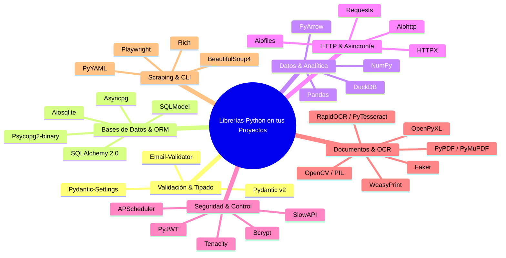

# 🐍 Librerías de Python: Referencia Técnica y Casos de Uso

> **Definición Clave para la Prueba:**  
> Una **Librería** es una colección de funciones, clases y módulos reutilizables que tú llamas explícitamente desde tu código para resolver un problema específico (serialización, operaciones matriciales, consultas SQL, etc.), manteniendo tú el control total del flujo de la aplicación.

---

## 📑 Clasificación Temática



---

## 1. Validación, Tipado & Configuración

### 🛡️ Pydantic (v2) & Pydantic-Settings
* **Propósito:** Validación de tipos en tiempo de ejecución, parsing y serialización de esquemas de datos con rendimiento optimizado en Rust (`pydantic-core`).
* **Diferencia Clave v1 vs v2:**
  * Métodos actualizados: `model_validate()`, `model_dump()`, `model_dump_json()`.
  * `BaseSettings` se movió al paquete independiente `pydantic-settings`.
* **Snippet Práctico:**
  ```python
  from pydantic import BaseModel, Field, EmailStr
  from pydantic_settings import BaseSettings

  class UserSchema(BaseModel):
      id: int
      username: str = Field(min_length=3, max_length=50)
      email: EmailStr
      is_active: bool = True

  class Settings(BaseSettings):
      DATABASE_URL: str
      OPENAI_API_KEY: str
      
      class Config:
          env_file = ".env"
  ```

---

## 2. Bases de Datos, ORMs & Drivers

### 🗄️ SQLAlchemy 2.0
* **Propósito:** El toolkit SQL y ORM más potente de Python. La versión 2.0 unifica la sintaxis declarativa tipada y añade soporte asíncrono de primer nivel.
* **Sintaxis Moderna (2.0):**
  ```python
  from sqlalchemy.orm import DeclarativeBase, Mapped, mapped_column
  from sqlalchemy import String, Integer, select
  from sqlalchemy.ext.asyncio import AsyncSession

  class Base(DeclarativeBase):
      pass

  class Customer(Base):
      __tablename__ = "customers"
      id: Mapped[int] = mapped_column(primary_key=True)
      name: Mapped[str] = mapped_column(String(100))
      churn_risk: Mapped[float]

  # Consulta moderna tipada:
  # stmt = select(Customer).where(Customer.churn_risk > 0.7)
  # result = await session.execute(stmt)
  ```

### ⚡ SQLModel
* **Propósito:** Diseñado por el creador de FastAPI (tiangolo) para combinar Pydantic y SQLAlchemy en una sola clase, eliminando la duplicación de código entre el esquema de la API y el modelo de base de datos.
* **Proyecto:** `Antigravit/Entrevistador`.

### 🔌 Drivers de Conexión
* **`psycopg2-binary`:** Driver C síncrono para PostgreSQL. Estándar para scripts y aplicaciones síncronas.
* **`asyncpg`:** Driver asíncrono de alto rendimiento para PostgreSQL. Esencial para FastAPI asíncrono con `create_async_engine("postgresql+asyncpg://...")`.
* **`aiosqlite`:** Driver asíncrono para bases de datos SQLite en entornos no bloqueantes.

---

## 3. Datos, Analítica & Formatos Columnares

### 🦆 DuckDB
* **Propósito:** Motor de base de datos analítico OLAP in-process. Diseñado para consultas SQL analíticas ultrarrápidas con procesamiento vectorial en CPU.
* **Por qué es clave en tu pipeline:** Permite consultar directamente archivos Parquet en disco o MinIO/S3 sin cargar los datos a memoria RAM completa:
  ```python
  import duckdb
  conn = duckdb.connect()
  # Consulta directa sobre archivos Parquet
  res = conn.execute("""
      SELECT region, SUM(sales_amount) as total
      FROM read_parquet('s3://lakehouse/silver/sales/*.parquet')
      GROUP BY region
  """).df()
  ```

### 🐼 Pandas vs 🔢 NumPy
* **Pandas:** Estructuras tabulares de alto nivel (`DataFrame`, `Series`) con etiquetas de filas y columnas. Ideal para limpieza de datos, joins, agrupaciones y análisis exploratorio (EDA).
* **NumPy:** Arreglos multidimensionales homogéneos (`ndarray`) y cálculo numérico puro. Base matemática de Python utilizada para operaciones vectoriales, distancias euclidianas y similitud de coseno en embeddings.
* **Archivo de caché `.npz`:** Utilizado en tu proyecto de embeddings para guardar y cargar matrices NumPy en disco de forma instantánea:
  ```python
  import numpy as np
  np.savez_compressed("embeddings_cache.npz", embeddings=matrix, ids=doc_ids)
  data = np.load("embeddings_cache.npz")
  ```

### 🏹 PyArrow
* **Propósito:** Implementación en Python del estándar Apache Arrow para almacenamiento columnar en memoria y manipulación de archivos **Apache Parquet**.
* **Ventaja:** Permite intercambio de datos a velocidad de bus de memoria (*Zero-Copy*) entre DuckDB, Spark y Pandas sin serializar a CSV.

---

## 4. Redes, HTTP & Asincronía

### 🌐 HTTPX vs Requests
* **`requests`:** El cliente HTTP síncrono estándar en Python. Bloquea el hilo mientras espera la respuesta. Excelente para scripts sencillos.
* **`httpx`:** Cliente HTTP moderno compatible con la API de `requests`, pero con soporte completo de **`async / await`** y **HTTP/2**. Es la librería obligatoria cuando haces peticiones externas desde dentro de endpoints asíncronos de FastAPI para no bloquear el bucle de eventos.
  ```python
  import httpx
  async with httpx.AsyncClient() as client:
      response = await client.get("https://api.example.com/data")
      data = response.json()
  ```

### 📁 Aiofiles
* **Propósito:** Manejo asíncrono de lectura y escritura de archivos en disco, evitando que operaciones I/O bloqueen el Event Loop en FastAPI.

---

## 5. Tareas, Seguridad & Resiliencia

### ⏰ APScheduler
* **Propósito:** Advanced Python Scheduler. Programa tareas periódicas en segundo plano (intervalos, fechas específicas o cron jobs) dentro del ciclo de vida del backend.
* **Uso en tus Proyectos:** Detección automática y periódica de métricas de churn de clientes cada X minutos en segundo plano.

### 🛡️ Bcrypt & PyJWT
* **`bcrypt`:** Algoritmo de hash de contraseñas con salado (*salt*) automático y factor de coste configurable para proteger credenciales en bases de datos.
* **`pyjwt`:** Creación, firmado y verificación criptográfica de tokens JSON Web Tokens (JWT) para autenticación sin estado (*stateless*) en APIs.

### 🔄 Tenacity
* **Propósito:** Librería general de reintentos basada en decoradores para llamadas a APIs externas que pueden fallar temporalmente (ej. límites de tasa de LLMs):
  ```python
  from tenacity import retry, stop_after_attempt, wait_exponential

  @retry(stop=stop_after_attempt(3), wait=wait_exponential(multiplier=1, min=2, max=10))
  def call_llm_api():
      ...
  ```

### 🚦 SlowAPI
* **Propósito:** Rate limiting para endpoints FastAPI, protegiendo las rutas contra abusos o ataques de denegación de servicio (DoS) limitando peticiones por IP o usuario (ej. `5 requests/minute`).

---

## 6. Documentos, OCR & Visión por Computador

### 📄 PyPDF vs PyMuPDF (fitz) vs WeasyPrint
* **`pypdf`:** Lectura, unión y extracción básica de texto estructurado de PDFs de manera 100% nativa en Python.
* **`PyMuPDF (fitz)`:** El lector de PDFs más rápido de Python (escrito en C), ideal para renderizar páginas a imágenes y extraer texto con coordenadas exactas.
* **`WeasyPrint`:** Motor de conversión de **HTML5 + CSS3 a PDF**. Permite diseñar contratos legales y reportes usando maquetación web moderna y compilarlos a documentos de calidad de imprenta.
* **`faker (locale='es_ES')`:** Generación masiva de datos sintéticos realistas (nombres en español, direcciones, importes monetarios y fechas) para pruebas de carga.

### 👁️ RapidOCR vs EasyOCR vs PyTesseract
* **`rapidocr-onnxruntime`:** El motor de OCR más eficiente y ligero para entornos de producción en CPU/GPU basado en el runtime ONNX de Baidu PaddleOCR. Extrae texto de imágenes escaneadas sin depender de binarios externos del sistema operativo.
* **`pytesseract`:** Wrapper de Python para el motor clásico Tesseract de Google; requiere tener instalado Tesseract a nivel del sistema operativo.
* **`opencv-python (cv2)`:** Procesamiento digital de imágenes: binarización, eliminación de ruido, corrección de perspectiva y umbralizado (thresholding) antes de enviar la imagen al motor OCR.
* **`rapidfuzz`:** Comparación de cadenas ultrarrápida mediante distancia de Levenshtein para emparejar nombres o palabras extraídas por OCR contra bases de datos reales a pesar de errores tipográficos.

---

## 7. Web Scraping & Automatización

### 🕷️ Playwright vs BeautifulSoup4
* **`playwright` (`sync_playwright` / `async_playwright`):** Controla instancias reales de navegadores (Chromium, Firefox, WebKit) en modo headless o con interfaz gráfica. Indispensable para scrapear páginas con Single Page Applications (React, Vue) que cargan su contenido mediante JavaScript.
* **`beautifulsoup4` + `lxml`:** Parser de HTML/XML estático. No ejecuta JavaScript, pero procesa miles de documentos HTML por segundo con consumo mínimo de CPU y RAM.
