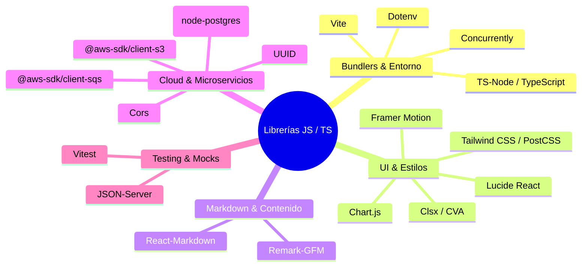

# ⚡ Librerías de JavaScript & TypeScript: Ecosistema Web y Node.js

> **Propósito:** Guía de referencia rápida para justificar la selección de librerías del ecosistema JavaScript, TypeScript, React y Node.js presentes en tus proyectos.

---

## 📑 Clasificación de Librerías JS/TS



---

## 1. Bundlers, Compiladores & Entorno

### ⚡ Vite
* **Propósito:** Entorno de desarrollo de frontend de nueva generación y empaquetador ultrarrápido para React y Vanilla JS.
* **Por qué supera a Webpack:**
  * En desarrollo no empaqueta todo el código por adelantado; sirve el código sobre **ES Modules (ESM)** nativos del navegador, lo que permite un arranque instantáneo sin importar el tamaño del proyecto.
  * Reemplazo de módulos en caliente (**Hot Module Replacement - HMR**) en milisegundos.
  * Para producción utiliza **Rollup**, generando bundles altamente optimizados y con tree-shaking automático.

### 🔄 Concurrently
* **Propósito:** Utilidad CLI de Node.js para ejecutar múltiples comandos npm/npx concurrentemente en una sola sesión de terminal con salidas prefijadas y coloreadas:
  ```json
  "scripts": {
    "dev": "concurrently \"npm run server:mock\" \"npm run client:vite\""
  }
  ```
* **Uso en tus Proyectos:** Levantar simultáneamente el mock server (`json-server`) y el frontend (`vite`) en las pruebas SPA de Riwi.

---

## 2. Componentes UI, Iconos & Estilizado

### 💎 Lucide React
* **Propósito:** Colección de más de 1,000 iconos vectoriales SVG limpios, modernos y consistentes para React.
* **Ventajas Técnicas:**
  * Componentes SVG directos con soporte completo de **Tree-Shaking** (solo se incluye en el bundle final el icono que importas).
  * Soporte total de props de Tailwind: `<CheckCircle className="w-5 h-5 text-emerald-400" />`.

### 🎭 Framer Motion
* **Propósito:** Librería de animaciones declarativas para React basada en física del mundo real (resortes, inercia, fricción).
* **Casos de Uso:**
  * Animaciones de entrada/salida de listas mediante `<AnimatePresence>`.
  * Gestos interactivos (drag, hover, tap).
  * Micro-interacciones fluidas en dashboards y asistentes conversacionales (*TokenSaver Web*).

### 📊 Chart.js
* **Propósito:** Librería de visualización de datos basada en HTML5 Canvas para renderizar gráficos reactivos 2D.
* **Ventajas:** Extremadamente ligera, responsiva y con animaciones de carga fluidas para gráficos de dona, líneas temporales y barras de retención.

### 🧩 Clsx & Class Variance Authority (CVA)
* **Propósito:**
  * **`clsx`:** Función utilitaria para construir cadenas de clases CSS condicionales de forma limpia: `clsx('base-class', isActive && 'bg-blue-600')`.
  * **`class-variance-authority (cva)`:** Estándar moderno de UI (base de Shadcn/ui) para crear componentes reutilizables con múltiples variantes tipadas (ej. botones con variantes: `primary`, `secondary`, `destructive`, y tamaños: `sm`, `md`, `lg`).

---

## 3. Renderizado de Contenido Dinámico

### 📝 React-Markdown & Remark-GFM
* **`react-markdown`:** Componente React que parsea y renderiza Markdown a elementos HTML reactivos de forma segura (sin `dangerouslySetInnerHTML`).
* **`remark-gfm`:** Plugin que añade soporte para la especificación GitHub Flavored Markdown (tablas, listas de tareas, URLs automáticas tachadas).
* **Uso en tus Proyectos:** En *Interview-Assistant*, renderiza las respuestas del asistente técnico en streaming con código formateado, listas y tablas.

---

## 4. Microservicios, AWS & Persistencia en Node.js

### ☁️ @aws-sdk/client-s3 & @aws-sdk/client-sqs
* **Propósito:** Clientes oficiales modulares del AWS SDK v3 para Node.js y TypeScript.
* **Por qué v3:** En la v3 de AWS SDK, cada servicio es un paquete independiente (`@aws-sdk/client-s3`), lo que reduce dramáticamente el tamaño de `node_modules` y permite tree-shaking en Lambdas o contenedores.
* **Uso en tus Proyectos:** En `gimnasio RIWI` y `RIWI OCR`, desacopla la ingesta de documentos subiendo archivos a S3 y enviando notificaciones a colas SQS para que los workers las procesen de forma asíncrona.

### 🐘 PG (node-postgres)
* **Propósito:** Cliente nativo de PostgreSQL para Node.js.
* **Características:** Soporte de connection pooling (`Pool`), transacciones parametrizadas seguras contra inyección SQL y streaming de resultados.

---

## 5. Testing & Mocks de Frontend

### 🧪 Vitest
* **Propósito:** Framework de pruebas unitarias nativo para Vite.
* **Por qué usarlo sobre Jest:**
  * Comparte exactamente la misma configuración de plugins, transformación de TypeScript y alias de rutas que `vite.config.ts`.
  * Mucho más rápido que Jest al no requerir transpilar con Babel de forma separada.
  * Soporte out-of-the-box de ESM y TypeScript sin configuración adicional.

### 🗄️ JSON-Server
* **Propósito:** Crea una API RESTful completa y funcional con operaciones CRUD en menos de 30 segundos a partir de un archivo `db.json`.
* **Cuándo USARLO:** Durante pruebas técnicas de frontend o prototipos cuando el backend real aún no está construido, permitiendo simular paginación, filtros (`/users?role=admin`) y relaciones.
