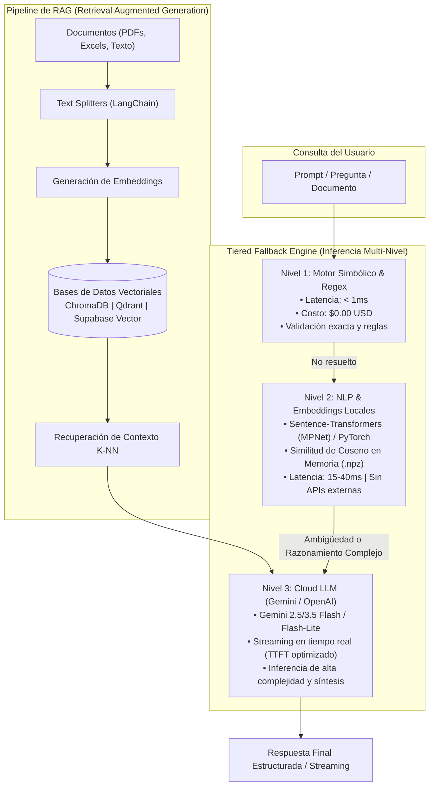

# 🧠 Inteligencia Artificial, LLMs, Agentes Autónomos & RAG

> **Área de Máxima Especialización:** Arquitectura de pipelines de IA generativa, optimización de latencia y costo de tokens, búsqueda semántica vectorial y orquestación multi-agente.

---

## 📑 Diagrama de Arquitectura de IA en tus Proyectos



---

## 1. SDKs de Modelos Fundacionales

### 🌟 Google GenAI SDK (`google-genai` en Python | `@google/genai` en JS)
* **Modelos Utilizados:** `gemini-2.5-flash`, `gemini-3.5-flash`, `gemini-3.5-flash-lite`.
* **Ventajas Competitivas:**
  * Ventana de contexto masiva (hasta 1M de tokens) que permite ingerir repositorios o expedientes enteros sin chunking agresivo.
  * Extrema eficiencia en latencia y costo con la variante `flash-lite`.
* **Métricas de Rendimiento:**
  * **TTFT (Time To First Token):** Tiempo desde que se envía el prompt hasta que el primer token llega a la pantalla. Medido en tus proyectos con `time.perf_counter()` para benchmark de experiencia de usuario.
* **Implementación con Streaming:**
  ```python
  import time
  from google import genai

  client = genai.Client()
  t0 = time.perf_counter()
  first_token_received = False

  response = client.models.generate_content_stream(
      model='gemini-2.5-flash',
      contents='Realiza un análisis de riesgos para este contrato...'
  )

  for chunk in response:
      if not first_token_received:
          ttft = time.perf_counter() - t0
          print(f"\n[TTFT: {ttft*1000:.2f} ms]\n")
          first_token_received = True
      print(chunk.text, end="", flush=True)
  ```

---

### 🌐 OpenAI SDK (`openai>=1.50.0`)
* **Uso en tus Proyectos:** `Antigravit/Agentes`, `Antigravit/HU_seman4_IA`, `Ruta_avanzada_IA/Desarrollo`.
* **Capacidades Destacadas:**
  * **Structured Outputs:** Garantiza que la respuesta del LLM se ajuste al 100% a un esquema JSON de Pydantic sin alucinaciones de formato:
    ```python
    from pydantic import BaseModel
    from openai import OpenAI

    class RiskAssessment(BaseModel):
        risk_level: str
        confidence: float
        recommendations: list[str]

    client = OpenAI()
    completion = client.beta.chat.completions.parse(
        model="gpt-4o-mini",
        messages=[{"role": "user", "content": "Analiza este texto..."}],
        response_format=RiskAssessment
    )
    result = completion.choices[0].message.parsed
    ```

---

## 2. Orquestación de Agentes & RAG

### 🦜🔗 LangChain & LangGraph
* **LangChain Core & Community:** Proporciona abstracciones para prompts, conectores de modelos (`ChatGoogleGenerativeAI`, `ChatOpenAI`) y cadenas de procesamiento.
* **LangChain Text Splitters:**
  * `RecursiveCharacterTextSplitter`: Divide documentos respetando párrafos, oraciones y saltos de línea para preservar el significado semántico en los chunks de RAG (típicamente `chunk_size=1000`, `chunk_overlap=200`).
* **LangGraph:**
  * Modela flujos conversacionales y sistemas multi-agente como **Grafos de Estado Cíclicos** (`StateGraph`).
  * Permite agentes con bucles de reflexión (agente intenta resolver -> herramienta responde -> agente valida -> si falla, reintenta).
  * Proyecto: `Antigravit/Entrevistador`.

---

## 3. Bases de Datos Vectoriales & Almacenamiento Semántico

| Base de Datos | Tipo | Despliegue | Casos de Uso en tus Proyectos |
| :--- | :--- | :--- | :--- |
| **ChromaDB** | Vector Store Embebido | Local en memoria o persistido en carpeta SQLite | Prototipos rápidos, asistentes de entrevistas técnicas (`Interview-Assistant`, `Entrevistador`). |
| **Qdrant** | Vector DB de Alto Rendimiento | Servidor Rust (Docker / Cloud) | Búsqueda vectorial con filtrado avanzado por metadatos (payload) en pruebas de escalabilidad (`Prueba_inicial`). |
| **Supabase Vector (pgvector)** | Extensión de PostgreSQL | PostgreSQL en la Nube | Arquitectura unificada de datos: los vectores de embeddings se almacenan en la misma base de datos relacional junto a los usuarios y logs (`Agentes`). |

---

## 4. NLP Local & Embeddings

### 🔢 Sentence-Transformers (`paraphrase-multilingual-mpnet-base-v2`)
* **Propósito:** Genera vectores densos de 768 dimensiones que capturan la semántica del texto en más de 50 idiomas (incluyendo Español e Inglés).
* **Ventaja:** Funciona completamente en local sin costo de API y permite calcular similitud semántica mediante el producto punto o similitud de coseno:
  $$\text{Similitud}(\mathbf{u}, \mathbf{v}) = \frac{\mathbf{u} \cdot \mathbf{v}}{\|\mathbf{u}\| \|\mathbf{v}\|}$$

### 💰 Tiktoken
* **Propósito:** Tokenizador BPE optimizado para el encoding `cl100k_base`.
* **Estrategia Token-Driven Development:**
  * Pre-calcular la cantidad de tokens de los documentos antes de consultar al LLM para seleccionar automáticamente el modelo más económico que soporte el tamaño requerido.

### 🌐 Deep-Translator & RapidFuzz
* **`deep-translator`:** Traducción dinámica multilingüe en tiempo de ejecución para normalizar entradas en múltiples idiomas antes del procesamiento por el motor de IA.
* **`rapidfuzz`:** Comparación difusa basada en Levenshtein para emparejar entidades extraídas (ej. nombres de clientes, ciudades) contra el catálogo maestro, tolerando errores tipográficos.

---

## 5. Automatización & Workflows con IA

### 🔄 n8n (Node-based Automation)
* **Propósito:** Plataforma de automatización de flujos basada en nodos para orquestar servicios de IA, webhooks y bases de datos sin escribir código de infraestructura repetitivo.
* **Uso en tus Proyectos:**
  * Webhook de entrada -> Extracción con PyPDF -> Enriquecimiento con LLM -> Envío de reporte a correo/Slack -> Persistencia en base de datos.
  * Documentado en tu escritorio en `Ruta_avanzada_IA/Manual tecnico n8n.md`.
