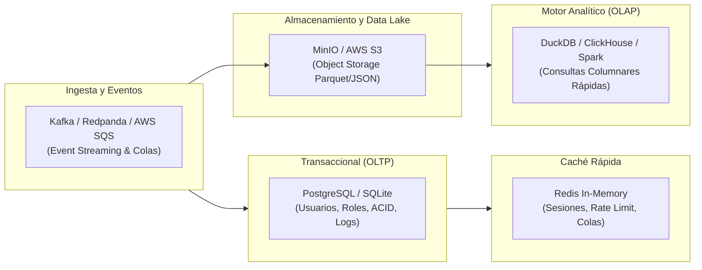

# 🗄️ Bases de Datos, Almacenamiento & Streaming de Eventos

> **Concepto Fundamental para la Prueba:**  
> La persistencia moderna se rige por el principio de **Persistencia Políglota** (*Polyglot Persistence*): no existe una base de datos que sirva para todo. Usamos bases de datos relacionales para transacciones ACID, almacenes columnares para analítica pesada, object storage para archivos y colas para desacoplamiento asíncrono.

---

## 📑 Matriz Comparativa de Persistencia en tus Proyectos

---

## 1. Bases de Datos Relacionales (OLTP)

### 🐘 PostgreSQL (v15, v16, v17)
* **Paradigma:** Relacional (RDBMS), ACID estricto, orientado a objetos.
* **Proyectos donde lo usas:** `pruebas/Pipeline-analitica`, `Riwi/ZOE-CARE`, `Antigravit/gimnasio RIWI`, `Antigravit/HU semana 10`, `Antigravit/RIWI OCR`.
* **Fortalezas Técnicas:**
  * Integridad referencial con claves foráneas, restricciones y transacciones seguras (`BEGIN ... COMMIT`).
  * Soporte de tipos avanzados: columnas `JSONB` indexables con GIN, arrays nativos y búsqueda Full-Text.
  * Extensiones potentes como `pgvector` para unificar búsqueda semántica en la misma base de datos.
* **Drivers en tus proyectos:** `psycopg2-binary` (síncrono), `asyncpg` (asíncrono en FastAPI), `pg` (Node.js).

---

### 🪶 SQLite 3
* **Paradigma:** Relacional embebido en archivo local (`.db` o `.sqlite`).
* **Proyectos donde lo usas:** `Ruta_avanzada_IA/Desarrollo/Sistemas` (`churn_monitor.db`), `Antigravit/Entrevistador`.
* **Fortalezas Técnicas:**
  * Cero configuración, no requiere servidor ni puertos abiertos.
  * Extrema velocidad de lectura en disco local.
* **Limitación Crítica:** No soporta escrituras concurrentes intensivas a través de la red (genera bloqueos de base de datos).

---

## 2. Bases de Datos Analíticas (OLAP) & Formatos Columnares

### 🦆 DuckDB (El SQLite de los Datos)
* **Paradigma:** OLAP Columnar In-Process.
* **Proyectos donde lo usas:** `pruebas/Pipeline-analitica`, `Antigravit/final_project`, `Antigravit/Ejercicios varios`.
* **Diferencia Técnica entre Row-Oriented (Postgres) y Column-Oriented (DuckDB):**
  * **Almacenamiento por Filas (Row-Store):** Lee toda la fila del disco. Excelente para: `SELECT * FROM users WHERE id = 42`.
  * **Almacenamiento por Columnas (Column-Store):** Lee solo las columnas consultadas. Excelente para: `SELECT category, AVG(price), SUM(quantity) FROM sales GROUP BY category`. Reduce la I/O de disco en un 90%+.
* **Integración con MinIO/S3:** DuckDB puede consultar directamente buckets S3 sin descargar los archivos completos mediante extensiones nativas (`INSTALL httpfs; LOAD httpfs;`).

---

### ⚡ ClickHouse
* **Paradigma:** Base de datos analítica columnar distribuida de alto rendimiento.
* **Proyectos donde lo usas:** `Antigravit/Ejercicios varios` (imagen Docker `clickhouse/clickhouse-server:24.3-alpine`).
* **Casos de Uso:** Ingesta de millones de eventos por segundo, analítica de clickstream, telemetría y consultas de agregación en tiempo real a escala masiva.

---

## 3. Caché & Bases de Datos NoSQL

### ⚡ Redis (v7)
* **Paradigma:** Almacén clave-valor en memoria RAM con persistencia opcional (RDB / AOF).
* **Estructuras de Datos Utilizadas:** Strings (tokens, flags), Hashes (perfiles de usuario en caché), Sets (listas de IDs únicos), Sorted Sets (tablas de clasificación por puntaje).
* **Casos de Uso:**
  * Caché de respuestas frecuentes para reducir la carga de PostgreSQL.
  * Almacenamiento de sesiones de usuario con tiempo de expiración (TTL).
  * Rate limiting con algoritmo Token Bucket / Leaky Bucket.

---

### 🍃 MongoDB (v6)
* **Paradigma:** Base de datos orientada a documentos (BSON).
* **Proyectos donde lo usas:** `Antigravit/final_project`, repositorios de Docker.
* **Cuándo Usarlo:** Esquemas dinámicos o polimórficos donde los documentos cambian frecuentemente de estructura y no se requieren joins relacionales complejos.

---

## 4. Almacenamiento de Objetos (Object Storage - S3)

### 📦 MinIO
* **Compatibilidad:** 100% compatible con la API de Amazon S3.
* **Proyectos donde lo usas:** `pruebas/Pipeline-analitica`, `Antigravit/final_project`, `Antigravit/Ejercicios varios` (imágenes `minio/minio:latest`).
* **Rol en la Arquitectura Medallón:**
  * **Bucket `bronze`:** Datos crudos (*raw*) tal cual llegan de las APIs o fuentes externas (CSV, JSON).
  * **Bucket `silver`:** Datos limpios, normalizados, sin duplicados y convertidos a formato columnar **Parquet**.
  * **Bucket `gold`:** Modelos de negocio agregados, métricas listas para dashboards y analítica avanzada.
* **Librerías de Conexión:** `boto3` en Python, `@aws-sdk/client-s3` en Node.js/TypeScript.

---

## 5. Streaming de Eventos & Colas de Mensajería

### 📬 Apache Kafka vs Redpanda vs AWS SQS

| Característica | Apache Kafka | Redpanda | AWS SQS |
| :--- | :--- | :--- | :--- |
| **Arquitectura** | Log distribuido particionado basado en commit-log | Compatible con Kafka, escrito en C++ con Seastar (sin JVM ni Zookeeper) | Cola de mensajes gestionada en la nube (Queue-based) |
| **Procesamiento** | Publicación / Suscripción con retención de días/meses | Mismo modelo que Kafka con menor latencia P99 | Mensajes efímeros que se eliminan tras ser procesados |
| **Replay de Eventos** | ✅ Sí (mover el offset hacia atrás) | ✅ Sí | ❌ No (una vez borrado, desaparece) |
| **Caso en tus Proyectos** | `Antigravit/Ejercicios varios` | `docker.redpanda.com/redpandadata` | `Antigravit/gimnasio RIWI` & `RIWI OCR` |

---

## 6. Gobernanza & Calidad de Datos

### 🏛️ OpenMetadata
* **Propósito:** Plataforma unificada de gobernanza de metadatos, catálogo de datos, descubrimiento y linaje (*Data Lineage*).
* **Proyectos donde lo usas:** `pruebas/Pipeline-analitica/src/governance` (`openmetadata_client.py`, `lineage_tracker.py`, imagen Docker `docker.getcollate.io/openmetadata/server:1.3.1`).
* **Conceptos Clave para la Prueba:**
  * **Linaje de Datos (Data Lineage):** Visualiza de dónde proviene cada dato y qué transformaciones sufrió (ej. API Ingestion ➔ Bronze S3 ➔ Spark Silver ➔ Gold KPI ➔ Streamlit Dashboard).
  * **Data Quality Gates:** Validaciones automáticas de calidad (reglas de nulls, unicidad de IDs, rangos numéricos) antes de permitir que los datos pasen de Silver a Gold.
