# 🗺️ Mapa de Proyectos en Desktop: Inventario & Stack Técnico

> **Uso en la Prueba Técnica:**  
> Este documento te permite respaldar cada afirmación con un proyecto real que tú mismo has construido o configurado en tu máquina local. Cuando el entrevistador pregunte: *"¿Tienes experiencia con X?"*, puedes citar el proyecto exacto, su arquitectura y los desafíos resueltos.

---

## 📑 Resumen General de Proyectos

```mermaid
graph TD
    DESK["Proyectos en Desktop (Sebastian Ortiz)"]
    
    DESK --> D_ENG["📊 Data Engineering & Big Data"]
    DESK --> D_AI["🧠 AI Engineering, RAG & Agentes"]
    DESK --> D_FULL["🌐 Full-Stack & Microservicios"]
    DESK --> D_TOOL["🛠️ Herramientas, OCR & Scraping"]

    D_ENG --> P1["Pipeline-analitica / final_project<br>(Spark, Airflow, DuckDB, MinIO, OpenMetadata)"]
    D_ENG --> P2["AIRFLOW<br>(Docker Compose, DAGs, Celery/Local)"]
    D_ENG --> P3["Ejercicios varios<br>(Kafka, ClickHouse, MinIO, PyArrow)"]

    D_AI --> P4["Entrevistador / Interview-Assistant<br>(LangGraph, ChromaDB, Google GenAI, React)"]
    D_AI --> P5["Agentes / AgenteIA<br>(Multi-Agente, Supabase Vector, OpenAI SDK)"]
    D_AI --> P6["JDS Sentinel AI / PEA 2.0<br>(Three.js, PyTorch, Tiktoken, Deep-Translator)"]
    D_AI --> P7["IA_Voz / Chatbot<br>(Gemini Streaming, @google/genai, Node.js)"]

    D_FULL --> P8["gimnasio RIWI / HU semana 10<br>(Microservicios, AWS SQS, S3, Express, FastAPI)"]
    D_FULL --> P9["RIWI_APP (Centinela)<br>(FastAPI, AsyncPG, SlowAPI, React, Vitest)"]
    D_FULL --> P10["ZOE-CARE / Pruebas SPA<br>(PostgreSQL, JSON-Server, MVC Vanilla JS, Tailwind)"]

    D_TOOL --> P11["RIWI OCR<br>(RapidOCR ONNX, OpenCV, PyMuPDF, SQS)"]
    D_TOOL --> P12["Scrapper / Generador Contratos<br>(Playwright, BeautifulSoup, WeasyPrint, Faker)"]
```

---

## 1. 📊 Data Engineering & Big Data Pipelines

### 🏆 `pruebas/Pipeline-analitica` & `Antigravit/final_project`
* **Ubicación:** `C:\Users\SEBAS\Desktop\pruebas\Pipeline-analitica`
* **Tipo de Proyecto:** **Proyecto Cooperativo / Colaborativo** (Equipo: *Sebastian Ortiz, Dylan Gamero, Sergio Tobias, Jefri Calderin, Hector, estebanp26, Luis Gomez*).
* **Rol / Arquitectura:** Pipeline analítico empresarial con **Arquitectura Medallón (Lakehouse)** y gobernanza de datos.
* **Stack Completo & Aportes de Equipo:**
  * **Procesamiento Distribuido:** Apache Spark 3.5.1 (`spark_medallion_job.py`, `spark_gold_models.py`).
  * **Orquestación:** Apache Airflow (`dag_medallion_pipeline.py`).
  * **Almacenamiento de Objetos:** MinIO (S3-compatible) con capas Bronze, Silver y Gold en formato **Apache Parquet**.
  * **Motor Analítico In-Process:** DuckDB (consultas SQL ultrarrápidas y normalizador de fechas por Dylan).
  * **LLM Local:** **Qwen 2.5 Coder** integrado localmente por Dylan Gamero para el chatbot sin timeouts.
  * **Data Observability:** Tema de observabilidad y dashboards interactivos en Streamlit & Plotly por Sergio Tobias.
  * **Gobernanza & Calidad:** OpenMetadata (`lineage_tracker.py`, catálogo de datos por Hector/Esteban) y Quality Gates declarativos con reglas `retail_rules.json` por Jefri Calderin.
  * **Backend & API:** FastAPI (`app/backend/main.py`), Pydantic v2, HTTPX.
  * **Testing:** Pytest completo (unit tests, integration tests con timeouts ajustados para Windows por Jefri).
* **Frase Clave para la Prueba:**
  > *"Diseñé e implementé un Data Lakehouse con Arquitectura Medallón donde los datos crudos ingresan a MinIO Bronze, se procesan y limpian con Spark hacia Parquet Silver con reglas de calidad automáticas, y se agregan en Gold para ser consumidos mediante DuckDB y Streamlit, registrando el linaje completo en OpenMetadata."*

---

### 🌪️ `AIRFLOW`
* **Ubicación:** `C:\Users\SEBAS\Desktop\AIRFLOW\airflow`
* **Rol:** Infraestructura de orquestación de flujos de trabajo basada en Docker Compose.
* **Stack:** Apache Airflow 2.8.1 / 3.3.2, PostgreSQL (Metastore), Redis (Broker Celery), Flower (monitoreo de workers).

---

### ⚡ `Antigravit/Ejercicios varios`
* **Ubicación:** `C:\Users\SEBAS\Desktop\Antigravit\Ejercicios varios`
* **Rol:** Laboratorio de streaming de eventos y analítica columnar masiva.
* **Stack:** Apache Kafka (`confluent-kafka`, `kafka-python-ng`), ClickHouse (`clickhouse-connect`), MinIO (`boto3`), DuckDB, PyArrow, FastAPI.

---

## 2. 🧠 AI Engineering, RAG & Agentes Autónomos

### 🎯 `Antigravit/Entrevistador` & `Antigravit/Interview-Assistant`
* **Ubicación:** `C:\Users\SEBAS\Desktop\Antigravit\Interview-Assistant` y `Antigravit\Entrevistador`
* **Rol:** Sistema asistente para entrevistas técnicas en inglés con RAG y grafos de estado.
* **Stack Backend:**
  * **Orquestación de Agentes:** **LangGraph** (grafos cíclicos de estado), **LangChain Core**.
  * **Base Vectorial:** **ChromaDB** (almacenamiento embebido de preguntas y criterios de evaluación).
  * **LLM:** **Google GenAI SDK** (`gemini-2.5-flash`, `gemini-3.5-flash-lite`).
  * **API & ORM:** FastAPI, SQLModel, Pydantic-Settings, PyJWT, PyPDF (ingesta de CVs y documentación).
* **Stack Frontend:**
  * React 18, TypeScript, Vite, Tailwind CSS, Lucide React, React-Markdown, Remark-GFM.

---

### 🤖 `Antigravit/Agentes` & `Antigravit/AgenteIA`
* **Ubicación:** `C:\Users\SEBAS\Desktop\Antigravit\Agentes` (clínica, la previa) y `AgenteIA`
* **Rol:** Arquitectura multi-agente para atención clínica y clasificación contextual.
* **Stack:**
  * **Vector DB en la Nube:** **Supabase Vector (pgvector)**.
  * **Inferencia:** OpenAI SDK (`gpt-4o-mini`), Google GenAI.
  * **Resiliencia:** `tenacity` para reintentos con retroceso exponencial.
  * **Infraestructura:** Docker Compose, Pytest-Asyncio, uv.

---

### 🌐 `Ruta_avanzada_IA/Desarrollo/Sistemas` (*JDS Sentinel AI*)
* **Ubicación:** `C:\Users\SEBAS\Desktop\Ruta_avanzada_IA\Desarrollo\Sistemas\HU_SEMANAÑ`
* **Rol:** Sistema de monitoreo de retención de clientes (Churn) con inferencia multinivel.
* **Stack:**
  * **Frontend:** Three.js (WebGL Shaders animados sobre Canvas), Chart.js (gráficos de sentimiento), Glassmorphism UI.
  * **Backend & Tareas:** FastAPI, APScheduler (evaluación de churn cada 10 min), SQLite (`churn_monitor.db`).
  * **IA Local:** PyTorch (`torch.nn` para atención local), Sentence-Transformers (`MPNet`), embeddings cacheados en `.npz`.

---

### 🎙️ `sebas/IA_Voz` & `sebas/Chatbot`
* **Ubicación:** `C:\Users\SEBAS\Desktop\sebas\IA_Voz` y `sebas\Chatbot`
* **Rol:** Asistente conversacional por voz y chat con streaming.
* **Stack:** Node.js, `@google/genai` (Google GenAI SDK para JavaScript), Web Audio, variables de entorno seguras (`dotenv`).

---

### 💰 `Antigravit/PEA_2.0`
* **Ubicación:** `C:\Users\SEBAS\Desktop\Antigravit\PEA_2.0`
* **Rol:** Optimizador de prompts y auditor de costos por tokens.
* **Stack:** Tiktoken (`cl100k_base`), Deep-Translator, FastAPI, Pydantic v2, Pytest-Asyncio.

---

## 3. 🌐 Full-Stack & Microservicios Basados en Eventos

### 📬 `Antigravit/gimnasio RIWI` & `Antigravit/HU semana 10`
* **Ubicación:** `C:\Users\SEBAS\Desktop\Antigravit\gimnasio RIWI`
* **Rol:** Plataforma modular de gestión basada en microservicios desacoplados por eventos.
* **Microservicios:**
  * `services/ingestion`: Recibe peticiones y encola en AWS SQS.
  * `services/department`: Lógica departamental y persistencia en PostgreSQL.
  * `services/intelligence`: Inferencia y análisis.
  * `front`: Frontend SPA en React / TypeScript con Vite.
* **Stack Cloud & Async:** `@aws-sdk/client-sqs`, `@aws-sdk/client-s3`, Express.js, TypeScript, PostgreSQL (`pg`), Docker Compose.

---

### 🛡️ `Antigravit/RIWI_APP` (Centinela / Shama)
* **Ubicación:** `C:\Users\SEBAS\Desktop\Antigravit\RIWI_APP\Centinela`
* **Tipo de Proyecto:** **Proyecto Cooperativo / Colaborativo** (Equipo: *Sebastian Ortiz, Daniel Martinez, Sebastian Castiblanco, jhonata0200p, Sbenavides14, Josue Blanco*).
* **Rol:** Backend seguro y resiliente con rate-limiting, reglas de negocio y control de acceso RBAC.
* **Stack & Aportes de Equipo:**
  * **FastAPI Asíncrono:** Arquitectura Shama v2.0-PRO consolidada por Sebastian Ortiz con SQLAlchemy asíncrono (**`asyncpg`** y **`aiosqlite`**).
  * **Seguridad & RBAC:** Aislamiento estricto de perfiles en login (`coder`, `staff`, `admin`) y anonimización bajo NDA por Daniel Martinez.
  * **Rate Limiting:** **SlowAPI** en endpoints de autenticación y radicación para evitar fuerza bruta.
  * **Reglas de Negocio RIC:** Validación condicional de turnos mañana/tarde y subsanación en vivo por jhonata0200p.
  * **Agendamiento:** Sistema de citas Paola/HSE con validaciones UX por Sbenavides14.
  * **Frontend & Responsive:** Layouts adaptativos en React/Vite por Sebastian Castiblanco y pruebas unitarias con Vitest.

---

### 🏥 `Riwi/ZOE-CARE` & `Riwi/Pruebas SPA simulacro`
* **Ubicación:** `C:\Users\SEBAS\Desktop\Riwi\ZOE-CARE`
* **Tipo de Proyecto:** **Proyecto Cooperativo / Colaborativo** (Equipo: *Alejandra Jimenez, Luis Medrano, Isac Alvarez, One/jebolivar, Diego Gonzalez, Nicolas Guarin, Jose Visbal, Maryuris Aragon, Sebastian Ortiz*).
* **Rol:** Sistemas de reservas y gestión médica hospitalaria en Single Page Applications.
* **Stack & Aportes de Equipo:**
  * **Frontend SPA:** Vanilla JS ES6+ modular con patrón **MVC** y Router propio por URL/Hash, gestionado por One y Luis Medrano.
  * **Cliente HTTP Unificado:** Módulo `httpClient.js` con captura global de errores e interceptor de endpoints.
  * **Backend & Persistencia:** Express.js con pool nativo **`pg.Pool`** sin ORM para alto rendimiento en 12 tablas clínicas relacionales (`agendamiento_citas`, `atencion_clinica`, etc.) por Isac y Luis.
  * **Mock & Tooling:** **JSON-Server** como mock REST API y `concurrently` para desarrollo concurrente local.
  * **Estilos:** Tailwind CSS v4 con `@tailwindcss/vite` y `@tailwindcss/postcss` por Alejandra Jimenez.

---

## 4. 🛠️ Herramientas, OCR, Scraping & Desktop

### 👁️ `Antigravit/RIWI OCR`
* **Ubicación:** `C:\Users\SEBAS\Desktop\Antigravit\RIWI OCR`
* **Rol:** Pipeline de reconocimiento óptico de caracteres para documentos escaneados.
* **Stack:** **RapidOCR-onnxruntime**, **OpenCV (cv2)**, **PyMuPDF (fitz)**, **RapidFuzz**, **PyTesseract**, AWS S3 y SQS.

---

### 🕷️ `Antigravit/scrapper` & `Ruta_avanzada_IA/generador_contratos.py`
* **Scrapper:** BeautifulSoup4, LXML, Requests, Rich para navegación estructurada de datos.
* **Generador de Contratos:** **WeasyPrint** (renderizado de HTML/CSS a PDF imprimible) con **Faker (es_ES)** para generación masiva de contratos legales con datos sintéticos realistas.

---

### 🖥️ `Antigravit/LicoreraCRM`
* **Ubicación:** `C:\Users\SEBAS\Desktop\Antigravit\LicoreraCRM`
* **Rol:** Aplicación de escritorio nativa para gestión de inventarios y clientes.
* **Stack:** Python, **Tkinter**, SQLite, empaquetada con **PyInstaller** en ejecutable `.exe` independiente.
