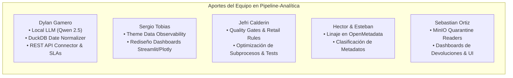
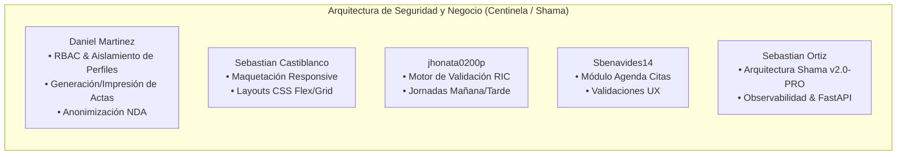

# 🤝 Tecnologías en Proyectos Cooperativos y de Equipo

> **Propósito para la Prueba Técnica:**  
> Este documento recopila todas las tecnologías, librerías, frameworks y patrones que fueron **introducidos, configurados o utilizados por tus compañeros de equipo y colaboradores** en proyectos grupales (`Pipeline-analitica`, `Centinela / Shama`, `ZOE-CARE`) y en repositorios colaborativos de referencia (`End-to-End-Data-Pipeline`, `full-stack-fastapi-template`, `500-AI-Agents-Projects`).  
> Te permite demostrar **habilidad de trabajo en equipo**, entendimiento del código ajeno y capacidad de integración en arquitecturas grupales.

---

## 📑 Índice de Proyectos Cooperativos

1. [Pipeline-analitica (Data Lakehouse & Observability Team)](#1-pipeline-analitica-data-lakehouse--observability-team)
2. [Centinela / Shama (Enterprise Security, RBAC & Workflows)](#2-centinela--shama-enterprise-security-rbac--workflows)
3. [ZOE-CARE (Healthcare Clinical SPA & Multi-Role)](#3-zoe-care-healthcare-clinical-spa--multi-role)
4. [Ecosistemas Colaborativos de Referencia (Big Data, Full-Stack & Agents)](#4-ecosistemas-colaborativos-de-referencia)

---

## 1. Pipeline-analitica (Data Lakehouse & Observability Team)

* **Equipo de Desarrollo:** Sebastian Ortiz, Dylan Gamero, Sergio Tobias, Jefri Calderin, Hector, estebanp26, Luis Gomez.
* **Módulo General:** Data Lakehouse con Arquitectura Medallón, Gobernanza y Asistente Conversacional.



### 🧠 A. Modelos Locales: Qwen 2.5 Coder & Ollama (Implementado por Dylan Gamero)
* **¿Qué es?:** Familia de LLMs open-source de Alibaba Cloud de última generación (`Qwen2.5-Coder`) ejecutados localmente mediante Ollama o Transformers sin depender de internet ni pagar por tokens.
* **¿Por qué lo integró el equipo?:** Dylan eliminó los timeouts y dependencias de APIs cloud en el chatbot analítico, integrando una base de conocimiento instantánea de las capas Medallón (Bronze, Silver, Gold) y consultas directas en DuckDB.
* **✅ Cuándo USARLO:**
  * Ambientes empresariales con políticas estrictas de privacidad (datos financieros, médicos o bajo NDA) donde ningún dato puede salir de la red local.
  * Cuando se requiere costo $0.00 por token y latencia predecible offline.
* **❌ Cuándo NO USARLO:**
  * Máquinas sin GPU dedicada (VRAM) o con recursos limitados de CPU/RAM (un modelo de 7B requiere al menos 8-16 GB de RAM).
  * Razonamiento ultra-complejo que solo modelos de frontera (Gemini 2.5 Pro o GPT-4o) resuelven.
* **💡 Alternativa:** **Google GenAI SDK (Gemini Flash-Lite)** si se permite salida a la nube con costo mínimo.

---

### 📊 B. Data Observability & Plotly Themes (Implementado por Sergio Tobias)
* **¿Qué es?:** Enfoque de observabilidad de datos (*Data Observability*) implementado sobre Streamlit y Plotly para monitorear el estado de los datos a través de 5 pilares: **Frescura (Freshness), Volumen, Calidad, Esquema y Linaje**.
* **¿Por qué lo integró el equipo?:** Sergio rediseñó los dashboards para que los ingenieros de datos identifiquen visualmente caídas de volumen, anomalías en pedidos y fallos en las capas de datos.
* **✅ Cuándo USARLO:** Dashboards operativos para equipos de ingeniería de datos y soporte donde la salud del pipeline es crítica.
* **❌ Cuándo NO USARLO:** Demos de usuario final no técnicas (donde solo interesan métricas comerciales como ventas y conversión).

---

### 🛡️ C. Quality Gates & Reglas de Calidad Declarativas (Implementado por Jefri Calderin)
* **¿Qué es?:** Motor de compuertas de calidad (*Quality Gates*) con reglas JSON declarativas (`retail_rules.json`).
* **¿Por qué lo integró el equipo?:** Jefri implementó la validación automática antes de promover datos de Silver a Gold: si un lote supera el 2% de registros nulos o claves duplicadas, se envía automáticamente al bucket de **Cuarentena** en MinIO.
* **✅ Cuándo USARLO:** Cualquier pipeline ETL de producción para evitar que datos corruptos lleguen a los reportes de directivos.
* **❌ Cuándo NO USARLO:** Ingestas exploratorias ad-hoc de una sola vez donde la velocidad prima sobre la integridad.

---

### 🏛️ D. Linaje y Clasificación en OpenMetadata (Implementado por Hector & Esteban)
* **¿Qué es?:** Clientes y emisores automáticos de linaje (`lineage_tracker.py`, `openmetadata_client.py`).
* **¿Por qué lo integró el equipo?:** Permite responder preguntas de auditoría como: *"Si modificamos la columna `price` en la API de origen, ¿qué dashboards y modelos Gold se verán afectados?"*.

---

## 2. Centinela / Shama (Enterprise Security, RBAC & Workflows)

* **Equipo de Desarrollo:** Sebastian Ortiz, Daniel Martinez, Sebastian Castiblanco, jhonata0200p, Sbenavides14, Josue Blanco.
* **Módulo General:** Plataforma interna con control de acceso basado en roles (RBAC), generación de documentos legales y reglas de negocio complejas.



### 🔒 A. Role-Based Access Control (RBAC) & Aislamiento de Perfiles (Daniel Martinez)
* **¿Qué es?:** Patrón de seguridad que restringe el acceso a endpoints y vistas según el rol verificado del usuario (`coder`, `staff`, `admin`).
* **Implementación:**
  * Middlewares y dependencias FastAPI (`Security(get_current_user)`) que verifican scopes en el token JWT.
  * Aislamiento estricto de vistas en el frontend: los perfiles de estudiantes solo ven sus casos; el staff puede evaluar políticas y resolver incidencias.
* **✅ Cuándo USARLO:** Sistemas multi-rol corporativos donde la privacidad de los datos es obligatoria.
* **❌ Cuándo NO USARLO:** Aplicaciones de usuario único o herramientas de uso interno no compartidas.

---

### 🚦 B. SlowAPI: Rate Limiting & Protección contra Fuerza Bruta (Daniel Martinez & Equipo)
* **¿Qué es?:** Librería de limitación de tasa (*Rate Limiting*) para FastAPI basada en `limits`.
* **¿Por qué se usó?:** Proteger endpoints críticos como `/api/auth/login` y formularios de radicación contra ataques de denegación de servicio (DoS) o scripts de fuerza bruta:
  ```python
  from slowapi import Limiter
  from slowapi.util import get_remote_address

  limiter = Limiter(key_func=get_remote_address)

  @app.post("/api/auth/login")
  @limiter.limit("5/minute")  # Máximo 5 intentos por minuto por IP
  async def login(request: Request):
      ...
  ```
* **✅ Cuándo USARLO:** Endpoints de autenticación, pagos o llamadas a APIs costosas de LLMs.
* **❌ Cuándo NO USARLO:** Endpoints internos de microservicio a microservicio dentro de una red privada confiable.

---

### 📜 C. Motor de Validación RIC & Subsanación en Vivo (jhonata0200p)
* **¿Qué es?:** Motor de reglas de negocio para el Reglamento Interno de Coders (RIC).
* **Aporte:** Implementó validaciones condicionales complejas (turnos mañana/tarde, cálculo de ausencias justificadas vs injustificadas) y refresco en tiempo real del estado de los casos para el estudiante.

---

## 3. ZOE-CARE (Healthcare Clinical SPA & Multi-Role)

* **Equipo de Desarrollo:** Alejandra Jimenez, Luis Medrano, Isac Alvarez (Coder R), One (jebolivar), Diego Gonzalez, Nicolas Guarin, Jose Visbal, Maryuris Aragon, Sebastian Ortiz.
* **Módulo General:** Sistema hospitalario para profesionales médicos, cuidadores y pacientes.

### 🌐 A. Cliente HTTP Unificado (`httpClient.js` por One & Luis Medrano)
* **¿Qué es?:** Módulo centralizado en Vanilla JS que envuelve la API `fetch` nativa.
* **Por qué es un excelente patrón:**
  * Centraliza la URL base (`http://localhost:3000/api`), el manejo de headers (`Content-Type: application/json`, `Authorization: Bearer ...`) y la captura global de errores 401/403/500, evitando repetir código en cada vista.
* **Snippet Clave:**
  ```javascript
  export const httpClient = {
    async get(endpoint) {
      const res = await fetch(`/api${endpoint}`);
      if (!res.ok) throw new Error(`HTTP Error: ${res.status}`);
      return await res.json();
    },
    async post(endpoint, data) {
      const res = await fetch(`/api${endpoint}`, {
        method: 'POST',
        headers: { 'Content-Type': 'application/json' },
        body: JSON.stringify(data)
      });
      return await res.json();
    }
  };
  ```

---

### 🐘 B. Pool Nativo de PostgreSQL (`pg.Pool` por Isac & Luis Medrano)
* **¿Qué es?:** Conexión directa a PostgreSQL en Node.js usando un **Connection Pool** sin ningún ORM.
* **¿Por qué lo usó el equipo?:** Para máxima velocidad en consultas relacionales complejas entre 12 tablas clínicas (`agendamiento_citas`, `atencion_clinica`, `medicamentos_paciente`, `bitacoras`).
* **Trade-off:** Requiere escribir SQL puro a mano, pero elimina el overhead de memoria de los ORMs en Node.js.

---

## 4. Ecosistemas Colaborativos de Referencia

En los repositorios comunitarios y de referencia encontrados en tu máquina (`End-to-End-Data-Pipeline`, `full-stack-fastapi-template`, `500-AI-Agents-Projects`), se destacan estas tecnologías clave:

### 📦 A. Great Expectations (Data Testing Industrial)
* **¿Qué es?:** Framework estándar de la industria en Python para validación, documentación y perfilado automatizado de datos.
* **Uso:** Define aserciones sobre datasets como pruebas unitarias:
  ```python
  import great_expectations as gx
  context = gx.get_context()
  # Aserción: La columna 'email' no puede tener nulos y debe tener formato válido
  validator.expect_column_values_to_not_be_null(column="email")
  validator.expect_column_values_to_match_regex(column="email", regex=r"^[\w\.-]+@[\w\.-]+\.\w+$")
  ```
* **Cuándo USARLO:** Pipelines de producción empresarial con SLAs estrictos de datos.

---

### 📈 B. MLflow (MLOps & Model Registry)
* **¿Qué es?:** Plataforma open-source para gestionar el ciclo de vida completo de Machine Learning (registro de parámetros, métricas, artefactos de modelos y despliegue).
* **Cuándo USARLO:** Cuando se entrenan múltiples versiones de modelos y necesitas comparar cuál tiene mejor precisión o menor latencia antes de promover a producción.

---

### ⚡ C. Apache Cassandra (NoSQL Wide-Column Store)
* **¿Qué es?:** Base de datos NoSQL distribuida diseñada para manejar cantidades colosales de datos a través de múltiples servidores sin un único punto de fallo (*Masterless Architecture*).
* **Cuándo USARLO:** Ingesta masiva de escrituras a alta velocidad (datos de IoT, sensores, logs de actividad de millones de usuarios).
* **Cuándo NO USARLO:** Si requieres consultas con `JOIN` relacionales o transacciones ACID complejas entre múltiples tablas (usa PostgreSQL).

---

### ❄️ D. Snowflake
* **¿Qué es?:** Data Warehouse analítico completamente gestionado en la nube con arquitectura de computación y almacenamiento desacoplados.
* **Cuándo USARLO:** Analítica corporativa a gran escala donde miles de analistas ejecutan consultas SQL concurrentes sin ralentizarse mutuamente.

---

### 🤖 E. CrewAI & AutoGen (Multi-Agent Role-Playing)
* **CrewAI:** Framework para coordinar agentes autónomos con roles jerárquicos (ej. Agente Investigador ➔ Agente Redactor ➔ Agente Editor). Cada uno con `role`, `goal`, `backstory` y herramientas.
* **Microsoft AutoGen:** Framework para conversaciones multi-agente donde los agentes interactúan entre sí en un chat grupal para resolver problemas complejos de código o análisis.

---

### 🔄 F. Alembic (Migraciones de Base de Datos para SQLAlchemy)
* **¿Qué es?:** Herramienta oficial de migraciones de base de datos para SQLAlchemy creada por su autor (Mike Bayer).
* **Por qué es obligatoria en equipo:** Permite que varios desarrolladores modifiquen modelos de datos sin perder información existente mediante scripts versionados (`alembic revision --autogenerate -m "add status column"`, `alembic upgrade head`).

---

### ⚡ G. TanStack Query (React Query)
* **¿Qué es?:** Librería de gestión de estado asíncrono y caché de servidor para React.
* **Ventajas:** Maneja automáticamente el estado de carga (`isLoading`), errores (`isError`), reintentos en segundo plano y revalidación de caché cuando el usuario vuelve a enfocar la pestaña del navegador.
